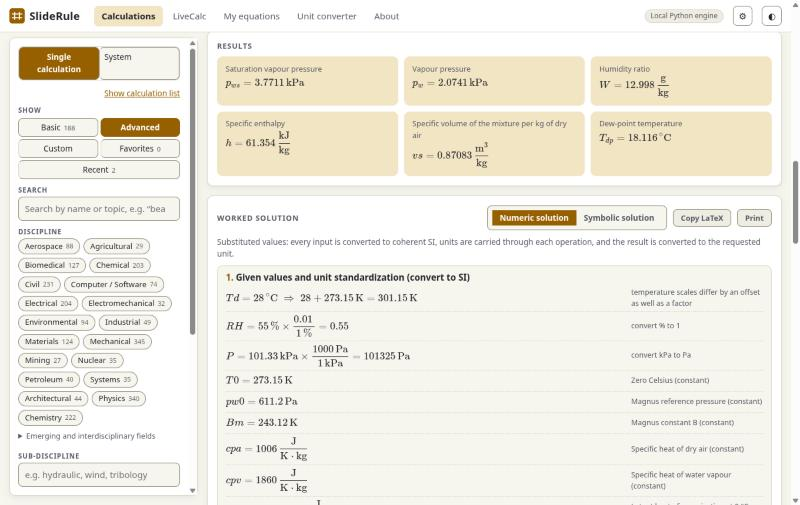
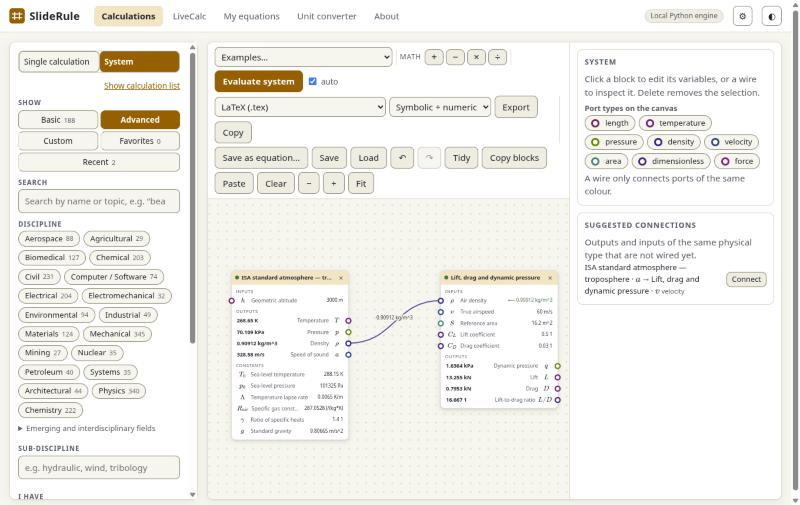
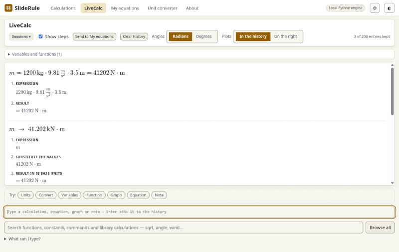

# SlideRule

Engineering calculations that **show their work**. Choose one of 1,377 calculations across 36 disciplines, enter values with units, and get the answer
together with a worked solution: the symbolic derivation, the numbers substituted, and every unit conversion. Solve for *any* variable, not only the
one the formula is written for. Deterministic code only: no LLMs or SLMs anywhere.

[](https://github.com/nhaliscak/SlideRule/actions/workflows/ci.yml)
MIT licence · Python 3.12+ ·
[Examples](examples/) · [Documentation](#documentation) · [Changelog](CHANGELOG.md) · [Support the project](#support)



> **Pre-1.0 and under active development.** About 225 of the most recently added formulas have been checked against published sources (two errors were found and fixed;
> see [docs/VERIFICATION.md](docs/VERIFICATION.md)); the roughly 990 earlier calculations have not been through those checks, so verify any result you rely on.
> Found a wrong result, a bug or something confusing? Please [open an issue](https://github.com/nhaliscak/SlideRule/issues) with the calculation, your inputs and what you expected.

## Quick start

SlideRule needs Python 3.12 or newer.

```bash
git clone https://github.com/nhaliscak/SlideRule && cd SlideRule
pip install ".[server]"        # use ".[desktop]" instead if you want the native window
sliderule serve                # opens http://127.0.0.1:8765
```

## What it does

* **Worked solutions.** Every result comes with the formula, the substituted values with units, each conversion and the unit reduction, in symbolic and numeric form.
* **Solve for anything.** Mark a different variable as the unknown and the equations are rearranged symbolically; what cannot be rearranged is found by bracketed root-finding.
* **Units checked everywhere.** A wrong dimension is rejected, mixed unit systems are flagged, and every equation is dimension-checked when it is loaded.
* **LiveCalc.** A unit-aware scratchpad: `5 m + 30 cm`, `120 km/h to m/s`, `f(x) = 3*x^2 - 2`, `plot sin(x) from 0 to 20`, with the working shown on request.
* **System Design.** Wire calculations together on a canvas, output port to input port of the same physical type, and evaluate the whole chain; export it to LaTeX, Python, Excel, MATLAB and more.
* **Beyond algebra.** Derivatives and integrals, ordinary and partial differential equations, boundary-value problems, series, stochastic and fractional equations, complex numbers, vectors and matrices.
* **Your own equations.** Define calculations with units in the browser or as plain JSON files and use them like the built-in ones.
* **Property data with sources.** Materials and fluids with the basis (minimum, typical, design, computed), the source and the uncertainty of every number, offered next to an input as **from data…**.
* **Runs where you are.** As a local web app in your browser, in a native window, from the command line, from Python, and over HTTP for other programs.

The complete feature list is in [docs/FEATURES.md](docs/FEATURES.md).

## Examples

Everything below was run; the output is real. The files are in [`examples/`](examples/).

### From the command line

```bash
sliderule solve civil.column.euler_buckling E="200 GPa" I="8.0e-6 m^4" L="3 m" K=1 --for Pcr --unit Pcr=kN
```
```
Pcr = 1754.6 kN   (Critical buckling load)
```

Add `--steps numeric` for the worked solution (it is printed as LaTeX; the app typesets it):

```
## Calculate Critical buckling load — Euler critical load
  P_{cr} = \frac{\pi^{2} E I}{K^{2} L^{2}}    % formula
  P_{cr} = \frac{\pi^{2} \cdot \left(2\times10^{11}\,\mathrm{Pa}\right) \cdot \left(8\times10^{-6}\,\mathrm{m}^{4}\right)}{\left(1\right)^{2} \cdot \left(3\,\mathrm{m}\right)^{2}}    % substitute SI values with units
  \left[P_{cr}\right] = \mathrm{Pa} \cdot \mathrm{m}^{2} = \frac{\mathrm{kg} \cdot \mathrm{m}}{\mathrm{s}^{2}} = \mathrm{N}    % unit reduction
  P_{cr} = 1.7546\times10^{6}\,\mathrm{N}    % result in SI
```

Solve the other way: which second moment of area carries 2000 kN on the same column?

```bash
sliderule solve civil.column.euler_buckling Pcr="2000 kN" E="200 GPa" L="3 m" K=1 --for I --unit I=mm^4
```
```
I = 9.1189e6 mm^4   (Second moment of area (weak axis))
```

Find calculations with `sliderule list` (`sliderule list buckling -d civil`, `sliderule list -d petroleum -v viscosity`), read one with `sliderule show ID`, convert units with
`sliderule convert 120 km/h m/s`. More in [`examples/01_command_line.sh`](examples/01_command_line.sh).

### From Python

```python
from sliderule import api

r = api.solve("civil.column.euler_buckling",
              {"E": "200 GPa", "I": "8.0e-6 m^4", "L": "3 m", "K": "1"},
              solve_for=["Pcr"], output_units={"Pcr": "kN"})
print(r["outputs"][0]["value"], r["outputs"][0]["unit"])      # 1754.59... kN
# r["steps"]["symbolic"] and r["steps"]["numeric"] hold the worked solution as data

# the same column, sweeping the length (the swept input is given as {"value", "unit"})
s = api.sweep("civil.column.euler_buckling", {"E": "200 GPa", "I": "8.0e-6 m^4", "L": {"value": 3, "unit": "m"}, "K": "1"},
              vary="L", values=[2, 3, 4, 5], solve_for=["Pcr"], output_units={"Pcr": "kN"})
print([round(v) for v in s["series"][0]["y"]])                # [3948, 1755, 987, 632]
```

See [`examples/02_python_api.py`](examples/02_python_api.py) for backward solving, property data and unit conversion.

### In LiveCalc

Type one line at a time; variables and functions carry on from line to line, and units are carried through.

| You type | You get |
|---|---|
| `5 m + 30 cm` | `5.3 m` |
| `120 km/h to m/s` | `33.333 m/s` |
| `m = 1200 kg`, `a = 9.81 m/s^2`, `F = m*a` | `11772 N` |
| `F to kN` | `11.772 kN` |
| `f(x) = 3*x^2 - 2`, then `f(4)` | `46` |
| `20 degC to degF` | `68 °F` |
| `5 m + 3 s` | refused: the dimensions differ |

The full syntax (lists, matrices, plots, integrals and more) is in [docs/LIVECALC.md](docs/LIVECALC.md); a session file you can paste is in [`examples/05_livecalc_session.txt`](examples/05_livecalc_session.txt).

### Property data with its source

```bash
sliderule data value materials-typical aluminium-6061-t6 youngs_modulus --unit GPa
sliderule data value fluids-coolprop water-liquid dynamic_viscosity --at 20 --at-unit degC --unit "mPa*s"
sliderule data value nist-cryo 304-stainless thermal_conductivity --at 77 --at-unit K
```
```
68.9 GPa  [typical; materials-typical v0.2.1]
1.0016 mPa*s at 20 degC  [computed, within 5 % of the reference; fluids-coolprop v0.1.0]
7.92063 W/(m*K) at 77 K  [computed, within 2 % of the reference; nist-cryo v0.1.0]
```

In a calculation, an input whose quantity matches (modulus, density, viscosity, conductivity ...) shows **from data…**: pick the material or fluid and a temperature, and the value is
filled in with its source, basis and uncertainty. The shipped packs and where every value comes from are in [DATA_SOURCES.md](DATA_SOURCES.md).

### Your own equation

Save this as `spring.json` ([`examples/04_spring_force.json`](examples/04_spring_force.json)):

```json
{ "format": "sliderule-calculation", "version": 1,
  "calculation": {
    "id": "custom.spring_force", "name": "Spring force", "description": "Hooke's law for a linear spring",
    "disciplines": ["mechanical"],
    "variables": [ {"key": "F", "label": "Force", "unit": "N"},
                   {"key": "k", "label": "Stiffness", "unit": "N/m", "example": "2 kN/m"},
                   {"key": "x", "label": "Extension", "unit": "m", "example": "5 cm"} ],
    "equations": [ {"title": "Hooke's law", "text": "F = k*x"} ], "outputs": ["F"] } }
```

```bash
sliderule custom import spring.json
sliderule solve custom.spring_force k="3 kN/m" x="2 cm" --for F        # F = 60 N   (Force)
```

It now appears in the app's search and on the System canvas, marked *custom*. Equations are dimension-checked when saved; see [docs/CUSTOM_EQUATIONS.md](docs/CUSTOM_EQUATIONS.md).

### From other programs

```bash
sliderule serve --no-browser          # or: sliderule app --api --api-token "$(openssl rand -hex 16)"
curl -X POST http://127.0.0.1:8765/api/rpc -H "Content-Type: application/json" \
     -d '{"method": "solve", "params": {"calc_id": "civil.column.euler_buckling",
          "inputs": {"E": "200 GPa", "I": "8.0e-6 m^4", "L": "3 m", "K": "1"}, "solve_for": ["Pcr"]}}'
```

Every function is reachable through that one endpoint; the safeguards (loopback-only, no cross-site requests, optional token) and the routes are described in [docs/API.md](docs/API.md).
A runnable client is [`examples/03_http_api.py`](examples/03_http_api.py).

## Ways to run it

| How | Command | Notes |
|---|---|---|
| **Local web app** | `sliderule serve` | After `pip install ".[server]"`. Add `--reload` while developing. |
| **Native window** | `sliderule app` | After `pip install ".[desktop]"`. The same interface in a desktop window. Tried on Linux (Qt); Windows and macOS are not tested yet. |
| **API for other programs** | `sliderule app --api` or `sliderule serve --no-browser` | See [docs/API.md](docs/API.md). |
| **Command line** | `sliderule list`, `show`, `solve`, `convert`, `data`, `custom`, `settings` | `sliderule --help`. |
| **Python library** | `from sliderule import api` | [`examples/02_python_api.py`](examples/02_python_api.py). |
| **Static website you host yourself** | `python scripts/build_web.py` | Writes `./site`, the same app running the Python engine in the browser (Pyodide). Host it on any static server; it needs a network connection once to fetch the Python runtime. There is no hosted demo. |

## A quick tour


*System Design: an ISA atmosphere wired into a lift and drag calculation.*


*LiveCalc: a unit calculation and a conversion, with their steps.*

A walkthrough of each tab is in [docs/FEATURES.md](docs/FEATURES.md#using-the-app).

## Documentation

| | |
|---|---|
| [docs/FEATURES.md](docs/FEATURES.md) | The full feature list and a walkthrough of the app |
| [docs/LIVECALC.md](docs/LIVECALC.md) | LiveCalc syntax: units, functions, lists, plots, sessions, export |
| [docs/CUSTOM_EQUATIONS.md](docs/CUSTOM_EQUATIONS.md) | Defining your own calculations, tables, vectors and matrices |
| [docs/API.md](docs/API.md) | Using SlideRule from other programs over HTTP |
| [docs/VERIFICATION.md](docs/VERIFICATION.md), [docs/EQUATION_AUDIT.md](docs/EQUATION_AUDIT.md) | What has been checked against sources, and what is still missing |
| [docs/COVERAGE.md](docs/COVERAGE.md), [docs/ROADMAP.md](docs/ROADMAP.md) | What the library covers, and what is planned |
| [docs/ARCHITECTURE.md](docs/ARCHITECTURE.md) | How it is built |
| [DATA_SOURCES.md](DATA_SOURCES.md), [docs/DATA_AND_STANDARDS_STRATEGY.md](docs/DATA_AND_STANDARDS_STRATEGY.md) | The property data, its sources and licences |
| [CHANGELOG.md](CHANGELOG.md), [PROJECT_LOG.md](PROJECT_LOG.md) | What changed, and the development record including dead ends |

## Troubleshooting

* **`sliderule` commands take a few seconds.** Each command loads the whole catalogue. For interactive use, `sliderule serve` or the Python library loads it once.
* **"Port already in use."** Pick another with `sliderule serve --port 8800`. `sliderule app` chooses a free port by itself; `--api-port` sets the API port.
* **A self-hosted static copy is blank on first load, or offline.** It needs a network connection once to fetch the Python runtime (`cdn.jsdelivr.net`). The local install does not.
* **`sliderule app` says no GUI toolkit was found.** Install one: `pip install "pywebview[qt]"` (the `desktop` extra does this on Linux), or use `sliderule serve`.
* **A calculation "took longer than 10 s".** Raise or switch off the limit in the app's Settings (the gear) or with `sliderule settings`.
* **A result looks wrong.** Check the assumptions listed under the calculation, then [open an issue](https://github.com/nhaliscak/SlideRule/issues/new/choose) using the "Wrong result" form.

## Accuracy and limits

Results are only as good as the assumptions listed under each calculation. SlideRule is a learning and checking aid, not a substitute for codes, standards or engineering judgement.
Nothing here is certified, the bundled property data is marked **not for design**, and the software comes with no warranty (see the licence). Do not use a result for a
safety-critical decision without checking it independently.

## Contributing

Bug reports and wrong-result reports are as valuable as code. See [CONTRIBUTING.md](CONTRIBUTING.md) (setup, the rules for formulas and data), the [code of conduct](CODE_OF_CONDUCT.md)
and the [security policy](SECURITY.md). Adding a calculation takes about 15 lines: see `src/sliderule/library/` and [docs/ARCHITECTURE.md](docs/ARCHITECTURE.md).

```bash
pip install -e ".[dev]"
ruff check . && pytest
```

## Support

SlideRule is free and MIT licensed. If it saves you time and you would like to say thanks, you can
[buy me a coffee](https://buymeacoffee.com/nhaliscak). Donations are entirely optional, unlock nothing, and do not buy priority for support requests;
issues and pull requests are welcome either way.

## Licence and data

Code: [MIT License](LICENSE). The four bundled datapacks and where every value comes from: [DATA_SOURCES.md](DATA_SOURCES.md). KaTeX (`web/vendor/katex`) keeps its own MIT licence file.
Copyrighted reference works are never stored in this repository; the importer in `scripts/import_crc_materials.py` builds a private pack on your own machine from a copy you own.
To cite SlideRule: [CITATION.cff](CITATION.cff).
