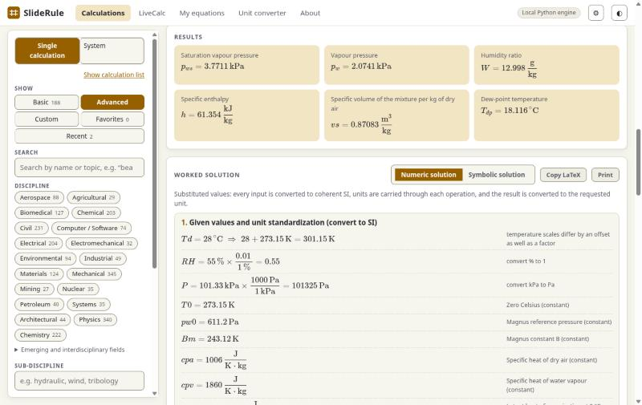
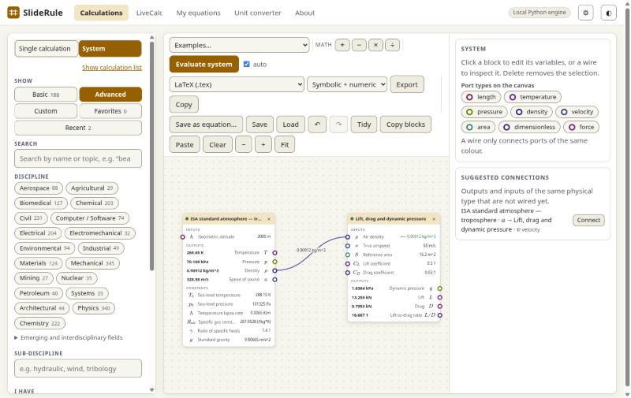
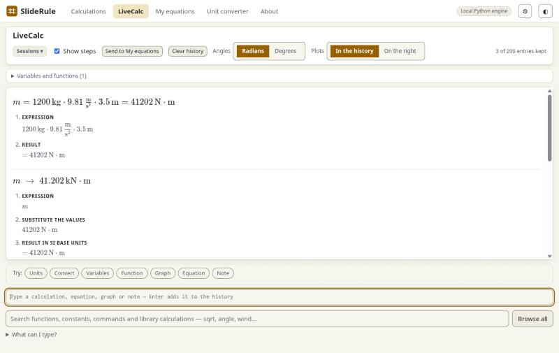

# Features

The full list of what SlideRule can do, as it grew. For a short overview and runnable examples see the [README](../README.md) and the [examples](../examples/) folder; the tabs of the app are walked through at the end of this page.

* 1377 calculations across 36 disciplines (civil, electrical, mechanical, chemical, petroleum, aerospace, environmental, architectural, industrial, systems, agricultural, biomedical, computer/software, materials, mining, nuclear, plus **physics** and **chemistry** as sciences (about 200 physics and 150 chemistry calculations: mechanics, analytical mechanics, fluids, thermodynamics, waves, optics, electromagnetism, quantum and statistical mechanics, atomic, nuclear, solid-state, plasma and particle physics, astrophysics and cosmology; general, physical, quantum, analytical, inorganic, organic, polymer, colloid, bio- and atmospheric chemistry, thermodynamics, kinetics, electrochemistry, spectroscopy: the textbook equations, each with a worked example and an independent hand-calculation test, and the classical engineering ones cross-listed under them), plus emerging fields such as quantum, AI/ML, robotics, energy, synthetic biology). Every discipline and sub-discipline in `docs/reference/disciplines.txt` has at least one calculation: see [docs/COVERAGE.md](COVERAGE.md)
* Dimensional analysis and unit standardization: wrong-dimension inputs are rejected, mixed unit systems are flagged, every equation is dimension-checked when loaded
* Solve for *any* quantity: tick "find" on a different variable and the equations are rearranged symbolically
* Filter by name, discipline, sub-discipline, the variables a calculation contains, or what it can solve for
* **LiveCalc**: a unit-aware scratchpad calculator. Type `5 m + 30 cm`, `120 km/h to m/s`, `m = 5 kg` then `F = m*a`, `f(x) = 3*x^2 - 2`, or `plot sin(x), cos(x) from 0 to 2*pi`; everything is evaluated as you type and shown as Markdown with maths, with a toggle for the worked steps (expression, values substituted, conversion to SI, result). A `calc(...)` library call is opened up into that calculation's own working (formulas, inputs in SI, each formula with the numbers put in, unit reduction), your own functions show their definition and body with the values in, and `integrate`, `derivative`, `findroot` and `sumover` show their method and numbers (plus the exact antiderivative or derivative, checked against the numeric answer, for plain unitless formulas). The last 30 entries are kept and variables carry from one to the next. Select a typed equation and send it to **My equations** with units already filled in from your variables. See [docs/LIVECALC.md](LIVECALC.md)
* **Solving a calculation, quality of life**: *Sweep one input* (under the inputs) graphs a result as one input varies (2–200 points, linear or logarithmic spacing, CSV download; `POST /api/calculations/{id}/sweep`, `api.sweep`); the unit you pick for a kind of quantity is remembered and the worked example is converted to it the next time; *Copy as text*, *Save case* and *Open case* (a small JSON file with inputs, unknowns and results) join *Copy link*; the filter boxes are now "I have" and "I need to find", with one-click quantity chips that only offer what the other filters leave.
* **System builder editing aids**: undo and redo (↶ ↷, Ctrl+Z, Ctrl+Shift+Z or Ctrl+Y; 100 steps, a burst of typing in a value box is one step), **Tidy** (arranges the blocks in columns by what feeds what), alignment guides while dragging a block (left edges, tops and bottoms line up with neighbours; hold Alt to drag freely), and **Suggested connections** (outputs and unwired inputs of the same physical type, shown for the selected block or the whole system, one click to wire).
* **Trust and polish**: references that were not checked against a source carry a visible "not verified" note on the calculation (the list is `src/sliderule/library/reference_status.py`; a test keeps it tied to the library), the About page says plainly what the checks do and do not cover, the bundled page and scripts are always revalidated so an update never shows stale code, form-control borders and the accent colour meet WCAG contrast (3:1 for controls, 4.5:1 for text) in both themes, the section tabs follow the arrow-key pattern, there is a skip link, and the star and the group arrows are no longer buttons inside a button.
* **LiveCalc additions**: `qr_q qr_r lu_p lu_l lu_u chol` (matrix factors, with units), 3-D lists (`T3[layer, row, column]`, `shape`, and `det trace inv eigvals rank cond transpose` layer by layer), `plot argand` and `plot nyquist` (critical point, gain and phase margins), **Pin** a graph above the history, and **Python** and **Notebook** export of a session (see [docs/LIVECALC.md](LIVECALC.md)).
* **More editing aids**: *Also vary* in the sweep panel draws one curve for each of up to six values of a second input; on the System canvas Shift-click chooses several blocks (Ctrl+A all), they move, copy (Ctrl+C), paste (Ctrl+V, wires between them included) and delete together.
* **Wires snap**: dragging a wire on the System canvas connects to the nearest compatible port within 28 px, you need not land on it; port and plot colours now meet 3:1 contrast in both themes.
* **What is missing**: [docs/EQUATION_AUDIT.md](EQUATION_AUDIT.md) lists, field by field, the standard equations the library does not have yet (548 checked topics: 81 covered, 112 partly, 355 missing) and a suggested first batch; [docs/ROADMAP.md](ROADMAP.md) lists what is noted for later. `python scripts/equation_audit.py` reruns the check.
* **Levels, favorites and groups** (the *Show* switch above the search in the Calculations tab): **Basic** lists the equations of classical mechanics (kinematics, forces, energy, momentum, rotation, oscillations, collisions, statics) and college-level chemistry (general, analytical, kinetics, thermodynamics, electrochemistry, atomic structure, organic), **Advanced** (the default) lists everything, **Favorites** is a shortlist you build by pressing ☆ on a calculation, and **Custom** shows your own groups: make a group with *New*, add calculations to it from the *Groups* menu beside a calculation's title, choose one group or all of them. The search, discipline and variable filters apply inside every level; favorites and groups are kept in this browser and, with the installed app, also in `lists.json` next to your equations (`~/.sliderule`), so another browser or computer that uses the same folder sees them: the newer copy wins as a whole, so a deletion is not undone (they can include your own equations). **Recent** lists what you opened lately. *Export* and *Import* (under Favorites and Custom) save favorites, groups, recent calculations and your own Basic choice to a file and merge such a file back in. With one group chosen, ▲ ▼ on a card set its order; *Change what Basic includes* lets you pick which sub-disciplines Basic means. Filters survive a reload, and the keys `/` (search), ↑ ↓ (move), Enter (open) and `f` (favorite) work in the list. `sliderule list --level basic` does the same on the command line.
* **System Design** (the *System* mode of the Calculations tab, sharing its search and filters; the canvas keeps its blocks when you switch back to a single calculation, until you press Clear): a canvas where equation blocks are clicked or dragged in and wired together. Each variable is an input, output or constant; wires only join ports of the same physical type; the whole system evaluates in dependency order with units converted on every wire. The whole system of equations can be exported as LaTeX (a compilable `.tex`), Markdown (`$…$` math) a printable, fully offline HTML page (KaTeX and its fonts are embedded; print-ready CSS) a MATLAB / Octave script, an Excel workbook whose cells hold the live formulas (editable inputs, named cells, a check column), or a standalone SymPy script that re-computes the system (numerically solved blocks are solved again with SciPy: initial-value problems with events, delay equations, boundary-value problems and partial differential equations) and checks itself against SlideRule's results, symbolic and/or numeric, including the closed-form output expressions composed across wires
* Equations can contain **derivatives and definite integrals** (`diff`, `integrate`); they are unit-checked as written, evaluated symbolically and can still be solved for any variable
* **Differential equations** (initial-value problems, first order up to systems and higher orders) are solved in closed form when SymPy can, so any variable can still be solved for, and numerically otherwise, with a plot of the solution and a table at chosen times; integrals without a closed form are integrated numerically
* **Partial differential equations** in one space dimension and time (diffusion/heat, waves with damping, advection–diffusion; value, slope and Robin conditions) by the method of lines, with an error estimate from grid refinement, profile and history plots
* **Conservation laws with shocks**: advection, Burgers, traffic flow, shallow-water dam breaks and other equations in conservation form by a limited finite-volume scheme
* **Coupled fields and 2-D transients**: several PDEs solved together (reaction-diffusion), time-dependent problems on a rectangle (including axisymmetric r–z cylinders, three-dimensional blocks, steady or transient, and L-shaped regions with rectangular cutouts), mixed derivatives, periodic domains, point sources and moving (Stefan) boundaries, by a vectorised method of lines with SciPy BDF and a sparse Jacobian
* **Steady 2-D problems** on rectangles (Laplace, Poisson, conduction with generation and convection, nonlinear variants) solved on a grid with Newton's method and shown as a colour map
* **Series**: `summation(term, (n, 1, 50))` for the textbook Fourier-series solutions of the heat, wave and Laplace equations (slab conduction, plucked string, plate temperature, square-wave harmonics), evaluated term by term, or to convergence for an infinite series (`(n, 1, oo)`: accelerated, cross-checked, and refused when it cannot be trusted); anything inside the series can be solved for by root-finding
* **Stochastic differential equations**: white-noise terms and Monte Carlo statistics (mean, spread, exceedance probability, quantiles) with a fixed seed and reported sampling error
* **Fractional derivatives**: `fdiff(y, t, 0.6)` (Caputo, orders up to 3 with the matching initial values) for viscoelastic creep, anomalous relaxation, fractional oscillators and other memory effects, by a predictor-corrector over the whole history
* **Delays and free boundaries**: `delay(y, tau)` for delay differential equations (method of steps with interpolated history) and boundary-value problems whose interval length is itself unknown
* **Hybrid systems and constraints**: events can make the state jump (bounces, relay thermostats, switching) and algebraic constraints are eliminated from the differential equations; larger systems (24 states, 6th order)
* **Boundary-value problems** (beams, fins, channel profiles: conditions at the ends of an interval, including slope and Robin conditions) are solved in closed form when possible and by multiple shooting otherwise; the plot covers the whole interval
* **Simultaneous equations**: coupled algebraic equations (linear: exact; nonlinear: Newton with an exact Jacobian and several starting points, reporting any second solution) such as Colebrook for the velocity of a given head loss, node voltages or a pipe junction
* **Cylindrical and spherical coordinates**: radial conduction, pipe flow, polytropes and axisymmetric problems with the axis or centre singularity (`u_x/r`) handled exactly, in closed form where SymPy can
* **Special functions**: Bessel (J, Y, I, K), Airy, Legendre, elliptic integrals, Lambert W, Bessel zeros and the Heisler eigenvalues, so the textbook Fourier–Bessel solutions and closed forms (annular fins, drums, pendulums) work, in every engine
* **Complex numbers** (phasors, impedance, complex power): `j` is the imaginary unit; a complex equation is split into real and imaginary parts and solved together, for magnitudes and angles in either direction
* **Gauge pressure and logarithmic levels**: `psig`, `barg`, `kPag` are offset units (absolute minus 1 atm) and dB levels follow the written definition with exact rearrangement of `log10`
* **Your own functions and products**: define a formula once (`fsj(Re, rel)`) and call it from several equations; `product(term, (i, 1, 6))` for loops that multiply
* **Data tables**: measured or published points (pump curves, steam tables, S-N data) become differentiable functions with linear, monotone-cubic or log-log interpolation; an unknown inside a table is found numerically
* **Vectors and matrices**: variables with a `shape` expand into components; `dot`, `cross`, `norm`, `det`, `inv`, matrix products and vector equations (`K*u = f`, `M = cross(r, F)`) are solved component by component, in either direction
* **Numerical inversion**: whatever cannot be rearranged (numerical ODE results, event times, integrals without closed forms, implicit equations like Colebrook) is found by bracketed root-finding, with an optional search range
* A **time limit for long calculations** (10 s by default, adjustable, or switched off after an explicit warning) in ⚙ Settings or `sliderule settings`, so a runaway symbolic problem cannot freeze the app
* **Property data (early)**: versioned *datapacks* hold material and fluid properties with the source, basis (minimum, typical, design, computed) and, where known, the spread or measured deviation for every number; bad data is refused when a pack loads. Properties can be single values or temperature curves that refuse to extrapolate. Four packs ship, all **not for design**: three typical materials (structural steel, aluminium 6061-T6, Ti-6Al-4V; sourced from 1972 NASA handbooks, NIST and National Bureau of Standards reports and a state manual), cryogenic conductivity and specific heat of 23 materials from NIST (with NIST's acknowledgement), water and dry air against temperature computed from published correlations, and about 30 common fluids (gases, hydrocarbons, solvents, refrigerants; liquid and gas, density, viscosity, conductivity, specific heat) computed with CoolProp. An importer for a source that cannot be redistributed (the CRC Handbook) builds a private pack on your own machine. In a calculation, an input whose quantity matches (density, viscosity, modulus, conductivity ...) shows **from data…**: pick the material or fluid (and a temperature), see the value with its basis, source and uncertainty, and use it; the source stays beside the number and is copied with the case. They are also reachable through `sliderule data list | show | value | validate` and the `/api/data` endpoints — see [docs/DATA_AND_STANDARDS_STRATEGY.md](DATA_AND_STANDARDS_STRATEGY.md) §10 to §12
* **My equations**: define your own calculations (variables with units, equations; dimension-checked when saved) in the browser or with `sliderule custom`, solve and wire them like any other, and share them as plain JSON files — see [docs/CUSTOM_EQUATIONS.md](CUSTOM_EQUATIONS.md)
* Two ways to run, one Python engine: a local install, and a static website you can host yourself that runs the same Python in the browser (Pyodide)

## Using the app

**1. Find a calculation.** In the *Calculations* tab, type in the search box or narrow the list by discipline, sub-discipline, the variables it contains, or what it can solve for. The *Show* switch (Basic, Advanced, Custom, Favorites, Recent) limits the list; *Hide calculation list* gives the detail pane more room. Click a calculation to open it.

**2. Enter values and read the working.** Fill in the inputs with a unit each (any unit of the right dimension; a wrong dimension is rejected and mixed unit systems are flagged). The results appear at the top in the units you choose, followed by the **worked solution**: the substituted values, every unit conversion and each step, with a symbolic version beside the numeric one. To solve for a different quantity, tick *find* next to it and the equations are rearranged.

**3. Join calculations into a system.** Switch the Calculations tab from *Single calculation* to *System*. Click or drag calculations from the list onto the canvas (or start from the *Start from an example* buttons or the *Examples…* menu), then drag from an output port to an input port of the same physical type, as in the example below where the density from an ISA atmosphere feeds a lift and drag calculation. *Evaluate system* solves the whole chain, and *Export* writes it out as LaTeX, Python or other formats.

**4. Use LiveCalc as a scratchpad.** The *LiveCalc* tab takes one line at a time: `m = 1200 kg * 9.81 m/s^2 * 3.5 m`, `m to kN*m`, `plot sin(x)*exp(-x/4) from 0 to 20`, or a call to a library calculation. *Show steps* displays how each line was evaluated, and *Send to My equations* turns a session into a reusable calculation.

**5. Keep your own.** *My equations* holds calculations you define or save (variables with units and dimension-checked equations); they appear in search and in the System canvas, marked *custom*.
